# 👋 Hi, I'm Keshav Kandoi

### AI Engineering · Backend Systems · Full-Stack Development

  
  
  

---

## About Me

I'm a software engineer focused on **AI systems, backend infrastructure, and full-stack product development**.

My work spans persistent memory for AI agents, retrieval-augmented generation, workflow orchestration, security automation, and model architectures implemented from first principles.

I enjoy engineering beyond the prototype: designing APIs, building asynchronous processing pipelines, evaluating retrieval quality, investigating failure modes, and connecting intelligent systems to real applications.

My current areas of focus include:

- **AI Agents & LLM Systems:** RAG, agentic workflows, memory architectures, tool integration, and MCP.
- **Backend Engineering:** FastAPI, distributed task processing, authentication, and reliable API design.
- **Search & Data Infrastructure:** Vector search, BM25, hybrid retrieval, reranking, relational and graph databases.
- **Model Engineering:** Transformer architectures, attention mechanisms, PyTorch training, and inference.
- **Software Security:** Static analysis, vulnerability detection, controlled remediation, and verification.

## Technical Skills

### Languages

### AI, Machine Learning & LLMs

**Core concepts:** Multi-Head Attention, Cross-Attention, Positional Encoding, Tokenization, Embeddings, Semantic Search, Hybrid Retrieval, RRF, Reranking, Prompt Engineering, Model Training, and Autoregressive Decoding.

### Backend & Distributed Systems

**Core concepts:** Asynchronous Processing, Background Workers, Task Queues, API Design, Webhooks, Scheduling, Retries, Deduplication, Authentication, and Authorization.

### Databases, Search & Storage

### Frontend & Mobile

### Engineering Tools & Practices

**Additional experience:** AST Analysis, Regular Expressions, Static Security Rules, Automated Testing, GitHub API Integrations, and CI Workflows.

---

## Featured Engineering Projects

### 01. MeMorae — Persistent Memory Infrastructure for AI Agents

**Long-term memory and hybrid retrieval for context-aware AI systems.**

Designed a memory infrastructure that extracts, organizes, stores, and retrieves information across conversations, helping AI applications maintain useful context beyond individual sessions.

**Engineering highlights:**

- Structured extraction of episodic, factual, semantic, and graph memories.
- Hybrid retrieval combining vector similarity search in Qdrant and BM25 keyword search in OpenSearch.
- Reciprocal Rank Fusion (RRF) to consolidate search results.
- PostgreSQL for source records, memory metadata, and lifecycle state.
- Neo4j for relationship-oriented memory representations.
- Asynchronous ingestion with Celery workers and Redis.
- SHA-256-based deduplication and memory conflict handling.
- Integration patterns for AI agents using MCP and LangGraph.

**Tech:** Python · FastAPI · PostgreSQL · Qdrant · OpenSearch · Neo4j · Redis · Celery · Gemini

### 02. Transformer — Architecture Implemented from First Principles

**An end-to-end implementation of the original encoder–decoder Transformer architecture, following _Attention Is All You Need_.**

Built the model and its training and inference pipeline using PyTorch, rather than relying on a pretrained Transformer implementation.

**Engineering highlights:**

- Implemented scaled dot-product attention and multi-head attention.
- Built encoder and decoder blocks with residual connections, normalization, and feed-forward networks.
- Implemented masked self-attention, cross-attention, and sinusoidal positional encoding.
- Developed tokenization, batching, teacher forcing, masked loss, and checkpoint handling.
- Implemented greedy and beam-search decoding.
- Built an interactive interface for inference and attention visualization.
- Added reproducible evaluation using frozen checkpoints and held-out splits.

**Tech:** Python · PyTorch · Transformers · Attention Mechanisms · Tokenization · Model Training

### 03. CodeSentinel — MCP Security Auditing & Controlled Remediation

**A local security auditing system exposed through the Model Context Protocol.**

Built to inspect source code, report supported security findings, investigate evidence, and support permission-controlled remediation with independent retesting.

**Engineering highlights:**

- Implemented 25 Node.js security rules covering supported static findings.
- Combined rule-based scanning with source inspection and security investigation.
- Integrated MCP tooling with developer agents, including Claude Code.
- Designed a controlled remediation workflow with explicit authorization.
- Implemented dry-run support, file-integrity checks, and guarded writes.
- Added retesting and security sweeps to distinguish proposed fixes from verified outcomes.
- Supported hash-checked rollback for controlled recovery.

**Tech:** TypeScript · Node.js · MCP · Static Analysis · AST · Regex · Zod · Security Testing

### 04. WorkForge — AI Workflow Automation Platform

**AI-assisted workflow orchestration across developer tools and business applications.**

Built an automation platform connecting application events, scheduled operations, and AI-generated task recommendations with real integrations.

**Engineering highlights:**

- Integrated GitHub, Gmail, Google Calendar, and Discord.
- Used Gemini for contextual summaries, task suggestions, and analysis.
- Used LangGraph for stateful workflow orchestration.
- Built API integrations and webhook-triggered automations.
- Implemented scheduled workflows and background operations.
- Added human approval for supported sensitive actions.
- Implemented organization-scoped integrations and encrypted OAuth token storage.

**Tech:** Python · FastAPI · LangGraph · Gemini · React · Supabase · REST APIs · OAuth · Webhooks

### 05. Let's Talk — Location-Based Social Application

**A mobile application designed to help people initiate real-world conversations based on nearby availability.**

- Built mobile flows for proximity-based discovery and social interaction.
- Implemented account authentication, profile management, and connection workflows.
- Developed real-time messaging and friend request functionality.
- Added QR-based connections and presence-oriented interaction.
- Prepared the application for closed testing through Google Play.

**Tech:** React Native · Expo · Node.js · Supabase · Real-Time Messaging

### 06. Offline AI Chatbot — Local LLM Desktop Application

**A desktop AI assistant designed for local inference without requiring a cloud-hosted LLM.**

- Integrated locally served language models through Ollama.
- Built a desktop application using Electron and React.
- Connected the user interface to a FastAPI backend.
- Designed the application around offline model execution.

**Tech:** Electron · React · Python · FastAPI · Ollama · Local LLMs

### Additional Work

**HealthGuard AI** — An AI-assisted health monitoring prototype combining machine learning workflows with a user-facing interface.

---

## GitHub Activity

---

## Engineering Interests

I'm particularly interested in the systems behind reliable AI applications:

- Retrieval quality, memory consistency, and efficient search.
- Stateful agent orchestration and secure tool execution.
- Distributed processing, fault tolerance, and backend reliability.
- Transformer internals, inference, and evaluation.
- Security-conscious development and automated verification.

I enjoy working on problems where **model behavior, software architecture, and real-world product requirements meet**.

---

### Let's Connect

I'm interested in **AI Engineering, LLM Engineering, Python Backend, and Software Engineering** opportunities.

[Portfolio](https://keshavkandoi.me) · [LinkedIn](https://www.linkedin.com/in/keshavkandoi/) · [GitHub](https://github.com/KeshavKandoi) · [Email](mailto:kandoikeshav2004@gmail.com)

Built through experimentation, iteration, and a lot of debugging.

